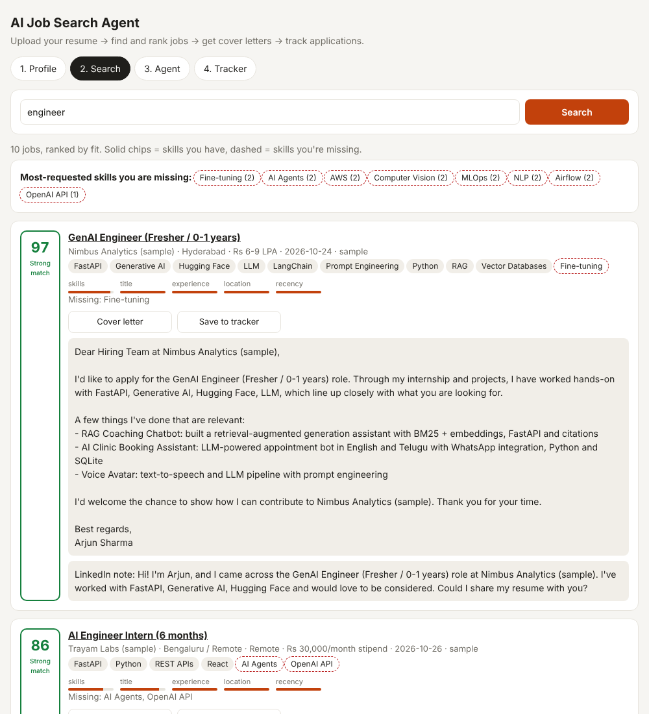
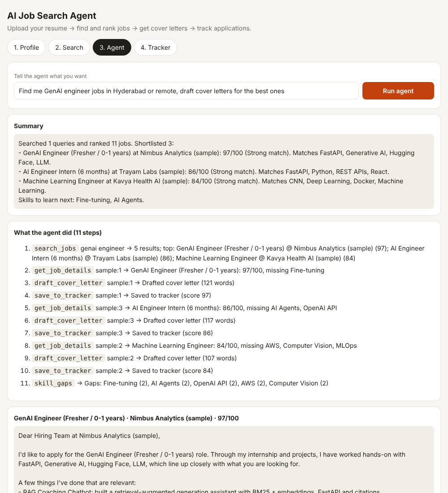
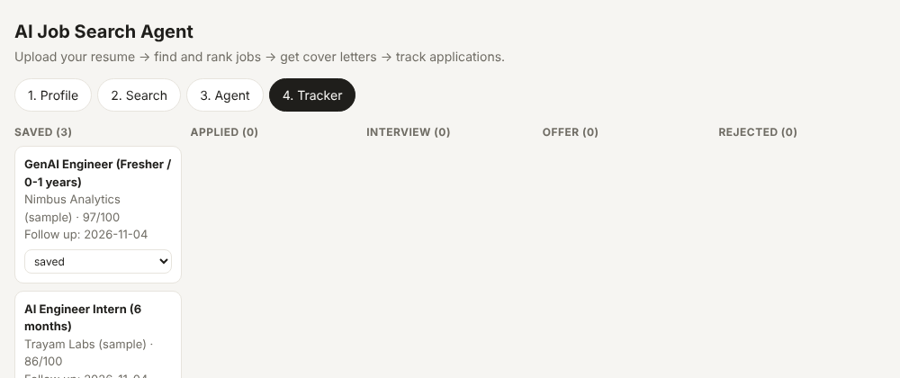

# AI Job Search Agent

An AI agent that runs your job search. It reads your resume, searches several job boards, **scores every job for fit with an explanation**, writes tailored cover letters and LinkedIn notes, tracks your applications, and tells you which skills to learn next.

| Ranked search with explanations | Agent run (step-by-step trace) |
|---|---|
|  |  |



## What it does

1. **Resume parsing** (PDF/TXT). It extracts skills from a taxonomy of about 120 skills with aliases ("sklearn" → Scikit-learn, "FAISS" → Vector Databases), works out years of experience from the date ranges in your Experience section, and suggests target roles.
2. **Multi-source job search**: [Remotive](https://remotive.com) and [Arbeitnow](https://www.arbeitnow.com) (free, no key), [Adzuna](https://developer.adzuna.com) (India listings, free key), plus a bundled sample set so it runs offline. Duplicates are removed, and one dead API never breaks a search.
3. **Explainable fit score (0–100)**, made of:
   - skills, 45% (exact matches, plus partial credit for related skills)
   - title vs target roles, 20% (with synonyms: GenAI ≈ LLM ≈ Generative AI)
   - experience, 15% (parses "3+ years", "2-4 yrs" and penalises senior titles)
   - location / remote, 12%
   - recency, 8%

   Each job shows the matched and missing skills and a breakdown bar.
4. **Skill-gap report**: the missing skills that appear most across your best-fitting jobs, i.e. what to learn next.
5. **Cover letters and recruiter notes**. With an LLM key they're written by the LLM, which is told to use only facts from the resume. Without one, a template picks your most relevant resume bullets.
6. **Agent mode**: give it a goal in plain English ("find GenAI jobs in Hyderabad and draft cover letters").
   - **With an LLM**, it's a real tool-calling agent. The model plans and calls `search_jobs`, `get_job_details`, `draft_cover_letter`, `save_to_tracker` and `skill_gaps` in a loop (max 8 steps).
   - **Without an LLM**, a deterministic pipeline runs the same tools in a fixed order.
   - Every run returns a step-by-step trace, so you can see what the agent did.
7. **Application tracker**: a kanban board (saved → applied → interview → offer / rejected) with follow-up reminders 7 days after saving.
8. **CLI + daily digest**: `python -m app.cli digest` writes a Markdown digest. The included GitHub Action can run it every morning.

## Tech stack

Python · FastAPI · SQLite · httpx · pypdf · OpenAI-compatible function calling (Groq / OpenAI) · vanilla HTML/JS · GitHub Actions

## Run it

```bash
git clone https://github.com/manikantar585-lgtm/AI-job-search-agent.git
cd AI-job-search-agent
python -m venv .venv && source .venv/bin/activate     # Windows: .venv\Scripts\activate
pip install -r requirements.txt
cp .env.example .env            # optional: LLM key, Adzuna key
uvicorn app.main:app --reload
```

Open http://localhost:8000:

1. **Profile**: upload your resume, check the skills, set your locations, and save.
2. **Search**: type a role and see ranked jobs. Click **Cover letter** or **Save to tracker**.
3. **Agent**: describe your goal and run it.
4. **Tracker**: move applications through the stages.

Try it with `data/sample_resume.txt` (a fictional candidate).

### CLI

```bash
python -m app.cli search "machine learning intern" --resume resume.pdf --location Hyderabad
python -m app.cli digest --resume resume.pdf --queries "genai engineer,ml engineer" --min-score 60 --out digest.md
```

### Daily digest on GitHub Actions

Add a repository secret `RESUME_TEXT` containing your resume as plain text. `.github/workflows/daily-digest.yml` then runs every day at 8:00 IST and uploads `digest.md` as an artifact.

## Tests

```bash
pytest -q
```

There are 14 tests covering skill extraction (including false positives like "CV" and "rest"), resume parsing, scoring, source parsing with mocked HTTP, resilience when a source is down, the offline pipeline, the **LLM tool-calling loop with a scripted model**, the full API flow and the CLI.

## Project structure

```
app/
  skills.py      skill taxonomy + extraction + "N years" parsing
  resume.py      resume → Profile (skills, experience, suggested roles)
  sources/       Remotive, Arbeitnow, Adzuna, sample data (normalised Job objects)
  matcher.py     explainable fit score + skill-gap report
  writer.py      cover letters, recruiter notes, resume tips
  agent.py       tool definitions, LLM tool-calling loop, offline pipeline
  llm.py         OpenAI-compatible client
  store.py       SQLite: profile, job cache, application tracker
  main.py        FastAPI routes
  cli.py         terminal search + digest
static/          single-page UI
data/            sample jobs (fictional companies) + sample resume
```

## Notes

- Sample jobs use fictional company names and example.com links. Live sources return real postings.
- Remotive and Arbeitnow focus on remote and European roles. For Indian city listings, add a free Adzuna key.
- Always review generated cover letters before sending.

## Author

Kunduru Manikanta Reddy · [LinkedIn](https://linkedin.com/in/manikanta-reddy-9a030932a) · [GitHub](https://github.com/manikantar585-lgtm)
